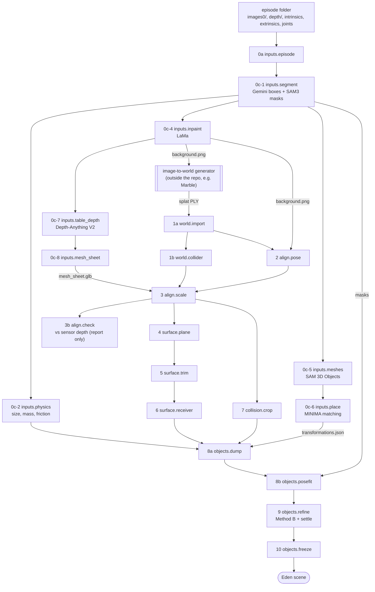

# real2sim_recon user guide

real2sim_recon turns one real robot episode into a simulation-ready scene for the
Eden simulator. The episode is a DROID recording: camera frames, depth, calibration
and joint states. The output has four parts:

- a photoreal Gaussian-splat background aligned to the real camera;
- a collision mesh;
- a fitted support table;
- object meshes posed as in the real frame.

The pipeline has 22 steps; one of them (`inputs.superres`) is optional and off by
default. Each step runs with one command, and every run records its exact arguments.

This page explains the method and how to use the repo. Two other pages go deeper:

- [pipeline.md](pipeline.md) lists every step's required inputs, outputs and options.
- [custom_capture.md](custom_capture.md) says what the input folder must contain
  and what to prepare for your own recording.

## How it works



The chain runs top to bottom. The splat generator is the one stage outside the
repo: any tool that turns `background.png` into a 3DGS PLY can be plugged in. Two
step-0 outputs skip ahead:

- `mesh_sheet.glb` is the scale reference for step 3.
- The masks and `transformations.json` feed the object steps.

## Method overview

The scene is rebuilt from a single calibrated camera view in six stages. Each stage
solves one problem and hands the next one a file.

1. **Inputs (step 0).**
   - Gemini, a vision-language model, lists the objects on the table and boxes
     them; SAM3 turns the boxes into masks.
   - Gemini also estimates each object's size, mass and friction.
   - LaMa inpaints the objects out of the frame, leaving an empty-table background
     image.
   - SAM 3D Objects reconstructs a textured mesh for each object.
   - Feature matching (MINIMA with LightGlue) of rendered mesh views against the
     frame recovers each object's scale and pose.
   - Depth-Anything V2, fitted to the robot's real depth, gives metric depth of the
     empty background. That depth is wrapped into a metric scene mesh
     (`mesh_sheet.glb`).
2. **World (step 1).** An image-to-world generator turns the inpainted background
   into a 3D Gaussian splat; the reference scenes use World Labs Marble. A Poisson
   surface reconstruction of that splat becomes the background collision mesh.
3. **Alignment (steps 2–3b).** The generated world lives in its own frame and scale.
   - The pose fit renders the splat from the real camera with gsplat and optimizes
     position and yaw.
   - Its loss is RGB error plus DINOv2 feature distance to the inpainted background.
     It searches globally with CMA-ES, then refines by gradient descent through the
     renderer.
   - It starts from the camera pose, since the world is generated around the input
     camera.
   - The scale fit then matches the posed collider to the metric scene mesh with a
     trimmed Chamfer distance inside the camera frustum.
   - A final check compares the aligned collider with the raw sensor depth and
     reports the error and the scale the sensor would prefer.
4. **Support surface (steps 4–6).**
   - A plane fit on the aligned collider finds the table: local normals, height
     slabs, region growing, then a robust fit snapped level.
   - Floater Gaussians around the table are trimmed.
   - The real table outline is traced from Gaussian centres near the plane, giving
     one polygon for physics and one for shadows.
5. **Collision crop (step 7).** The aligned collider is baked into world coordinates
   and cropped to the robot's reach, so physics only handles nearby geometry.
6. **Objects (steps 8–10).**
   - Objects are first placed exactly as the simulator will load them.
   - Their position and yaw are fitted to the real masks (silhouette IoU).
   - A joint refinement adds scale, an upright correction and three priors: Gemini's
     size estimate, real depth, and a grasp anchor from the recorded gripper-close
     frames.
   - Each candidate layout is checked by settling it in physics.
   - The chosen layout is frozen with its hash, so evaluations stay reproducible.

Design choices that hold across stages:

- **One source of truth for frames.** Every step that places the splat or collider
  uses one module (`r2s/common/transforms.py`).
- **Defaults are the reference settings.** A plain `r2s run <step> --scene <s>`
  reproduces the reference pipeline.
- **No silent fallbacks.** A missing input stops the step with a list of what is
  missing.
- **Recorded runs.** Each scene's `manifest.json` records every step's arguments and
  input fingerprints.

## Requirements and installation

**Hardware:** Linux and one NVIDIA GPU for the GPU steps (developed on RTX 6000 Ada,
L40S and A100). Steps 3b–8b and 10 run on CPU, most of them in seconds.

**Software:**

| Component | Needed for | Notes |
|---|---|---|
| [Eden](https://github.com/Kashu7100/Eden) checkout, branch `robotarena360` | the env every step runs in; the simulator | the repo builds its env from Eden's `uv.lock`; verified at commit `b7c85cc` ([setup.md](setup.md#1-eden)) |
| `uv` | building the env |  |
| Open3D 0.19.0 | step 1b (collider) | installed into the repo env by `setup_env.sh`, the version the old collider tool used |
| CUDA toolkit matching torch (13.0) | gsplat's one-time CUDA build | `nvcc` on the host; set `CUDA_HOME` |
| conda envs `gemini`, `lama`, `sam3d-objects`, `match`, `moge` (and optional `invsr`) | step 0 | the model projects' own environments |
| model weights | step 0 | SAM3, Depth-Anything V2 and MoGe from the Hugging Face cache; big-lama, MINIMA/LightGlue and SAM 3D Objects checkpoints from their projects |

**Install:**

1. Clone this repo, and Eden on its `robotarena360` branch:

   ```bash
   git clone -b robotarena360 https://github.com/Kashu7100/Eden.git
   ```

2. Copy the machine template and fill in your folders:

   ```bash
   cp configs/local.env.example configs/local.env
   ```

   The file sets, among others:

   - `R2S_EDEN`, the Eden checkout;
   - `R2S_WORK_ROOT`, where runs, the env and caches go;
   - `CUDA_HOME`;
   - `R2S_DATA`, where existing step-0 data lives;
   - the model folders;
   - the Slurm partition.

   It is gitignored, and `scripts/env.sh` loads it. `configs/paths.yaml` maps these
   variables to the pipeline's roots and holds no machine paths.
3. Build the environment from Eden's lock file. This installs Eden's dependencies
   plus gsplat, and adds Eden and this repo through `.pth` files, so nothing is
   written into Eden:

   ```bash
   bash scripts/setup_env.sh          # env goes to $R2S_WORK_ROOT/envs/eden
   ```

4. Compile gsplat's CUDA extension once, on a GPU node; it takes about 6 min. It is
   cached in `$TORCH_EXTENSIONS_DIR` for every architecture in
   `TORCH_CUDA_ARCH_LIST`:

   ```bash
   source scripts/env.sh && python -c "from gsplat.cuda._backend import _C"
   ```

5. Check the install:

   ```bash
   source scripts/env.sh && r2s doctor && r2s list && python -m pytest -q tests
   ```

   `r2s doctor` prints one OK / WARN / FAIL line each for the imports, the gsplat
   build, the GPU, the Eden commit, every path, every conda env and every model
   weight.

The model conda envs are called directly by path (`R2S_CONDA_ROOT`), so
you never activate them yourself. Gemini steps read the key from `GEMINI_API_KEY`
only.

## Quickstart

This walks one scene from a raw DROID episode to a layout the simulator can load.
Every command takes `--scene`. Run GPU steps on a GPU node, for example through
`scripts/slurm/submit.sh scripts/slurm/step.sbatch <same arguments>`.

```bash
source scripts/env.sh
export R2S_WORK=$R2S_WORK_ROOT/runs/first_try           # all outputs of this run

# 0. Inputs from the episode (writes <work>/scene_data/...)
r2s run inputs.episode --scene droid2 --src /path/to/episode/droid2
r2s check --scene droid2                                # validates the episode folder
r2s pipeline --scene droid2 --from inputs.segment --to inputs.mesh_sheet   # GPU node, GEMINI_API_KEY

# 1. Generate a splat of <work>/scene_data/scene_background/droid2/background.png with
#    your image-to-world generator; save it as <splat_source_dir>/droid2.ply
r2s pipeline --scene droid2 --from world.import --to objects.refine        # GPU node
r2s run objects.freeze --scene droid2 --tag B_v1

r2s status --scene droid2                               # every step: ok / failed, when, how long
r2s export --scene droid2 --to /path/to/eval            # old-evaluator layout
```

Once `inputs.episode` has imported the scene, steps 1-10 read its step-0 files from
the run's own `scene_data/`. `r2s run` prints the inputs root it used, so there is
nothing to repoint.

**Check the alignment:** look at `align/pose_fit_overlay.png`,
`align/scale_refined_snapshot.png` and `align/depth_check.png`. `align/depth_check.json`
gives the error against your depth sensor.

**Picking a layout:** `objects.freeze` needs a layout source:

- `--tag B_v1` uses the Method B result from step 9;
- `--from <candidate.json>` uses any file;
- `--refiner-round` uses a reviewed layout, and can be set per scene in
  `configs/scenes.yaml`.

**Resuming:** `r2s pipeline ... --skip-done` skips steps whose manifest record is
"ok" and whose outputs exist. After a failure the pipeline prints the command that
resumes from the failed step. `--dry-run` prints the plan.

**One step at a time:** `r2s run <step> --scene <s> --help` lists the step's
options; the defaults are the reference settings.

**Your own recording:** [custom_capture.md](custom_capture.md) says what the input
folder must contain and what to prepare before running a custom scene.

## Concepts

**Scene.** One real episode, named like `droid2`. `configs/scenes.yaml` registers
known scenes and their per-scene options, such as:

- `scene_type: DROID|bridge`;
- the robot;
- the collider preset;
- the scale-fit truncation.

An unknown scene name still works with the defaults.

**Run.** One output folder: `work` in `configs/paths.yaml`; set `R2S_WORK` to start
another. A run holds one folder per scene (`<work>/scenes/<s>/`).

Step 0 writes into `<work>/scene_data/`, laid out the way the original asset
pipeline laid out its data, so existing tools can read it. Steps 1-10 read a scene's
step-0 files from there once the scene has been imported. Otherwise they read from
`scene_data`, the shared existing data.

**Configuration:**

- **`configs/local.env`** (gitignored; template `configs/local.env.example`) holds
  this machine's folders and Slurm settings, and `scripts/env.sh` loads it.
- **`configs/paths.yaml`** maps those variables to the pipeline's root folders. A
  value can use `${ENV}`, `${ENV:-default}` and `{other_key}`, and it holds no
  machine paths.
- **`configs/scenes.yaml`** holds a `defaults` block plus one entry per scene. Under
  a step's name, its keys become that step's option defaults for that scene. A
  command-line flag still wins.

**Manifest.** Each step run writes a record to `<work>/scenes/<s>/manifest.json`:

- arguments and the inputs root;
- input fingerprints (size, mtime, hash of the first and last MiB);
- outputs;
- git revision, host, Slurm job id and duration.

`r2s status --scene <s>` summarises it.

**Safety rules:**

- Steps never write into their input folders.
- Every output goes through `r2s.common.io.prepare_output`, which removes a symlink
  before writing. You can therefore seed a run with links to read-only data without
  risk.
- A missing input stops the step; nothing falls back silently.

**Coordinate conventions:**

- **World frame:** the robot base frame, z up, in metres. Quaternions are `wxyz`.
- **Camera:** `intrinsics.npy` is the 3×3 K; `extrinsics.npy` is the 4×4 OpenCV
  world-to-camera matrix. The image size is twice the principal point.
- **Alignment pose:** `aligned_pose*.npy` is `[tx, ty, tz, yaw]` (or
  `[tx, ty, tz, rx, ry, rz]`); the scale is a scalar `.npy`.
- **Placement:**
  - The splat is placed at `x_world = s · R(q_rel ⊗ ADJ ⊗ BASE) · x + t`.
  - The collider is placed at `x_world = R(q_rel ⊗ ADJ) · (s · C · x_glb) + t`.
  - BASE rotates the splat into z-up, ADJ is a fixed 178°-about-Y correction, and C
    is the y-up-to-z-up GLB conversion.
- **GLB meshes** are y-up and converted on import.

## Using the result in Eden

A finished scene folder holds everything an Eden scene needs. These are the files
and the Eden options they map to:

| Scene part | File in `S/` | Eden option |
|---|---|---|
| Splat background | `world/gaussian_trimmed.ply` + `align/aligned_pose_refined.npy` + `align/aligned_pose_scene_scale_refined.npy` | `PCDOptions(path, scale=s, pos=t, quat=q_rel ⊗ ADJ ⊗ BASE)` |
| Background collider | `cropped_collision/reachable_collider_*.glb` (already in world coordinates) | `EntityOptions(file, scale=1, pos=0, up=(0,0,1), fixed, convexify)` |
| Table physics | `surface/operation_surface_shadow_v2.json` (`footprints.physics`) | a fixed prism entity (`r2s.surface.runtime.load_operation_surface_boxes`) |
| Objects | `objects/stock/object_poses.json` (load poses) + `objects/layout/candidate.json` (chosen layout) | one `EntityOptions` per object, then the layout as pose and scale overrides |
| Camera | `IN/intrinsics.npy`, `IN/extrinsics.npy` | `CameraOptions` with position, look-at and vertical FOV from the calibration |

**Splat position at Eden HEAD:** pass `pos = t`, not `t / s`. Eden's gsplat renderer
computes `R · (s · x) + pos`; the older 2DGS renderer computed `s · (R · x + pos)`.

**The simplest starting point** is
`r2s/sim/scene.py:build_scene(layout, dump_path=..., run_dir=...)`. It builds the
complete Eden scene the object steps use:

- the collider;
- the table prism;
- the objects;
- a DROID Franka with a Robotiq 2F-85;
- cameras with the splat.

**Older evaluators** expect `optimization_results/<s>/` and `echo2/<s>/` folders.
`r2s export --scene <s> --to DIR` symlinks the same files into that layout (or
copies them, with `--copy`). Pass the scale file explicitly to such an evaluator.

**Object layout overrides:** the frozen `candidate.json` is consumed with:

```
--object-pose-override <cand> --object-pose-override-mode absolute
--object-pose-override-max-displacement 0.05 --object-scale-override <cand>
```

Rendering fidelity (shadow compositing, Nyx) is not part of this repo. A scene built
from these files renders the splat and meshes as Eden does by default.

## Repository layout

The package has one subpackage per stage and one module per step. Each step module
exposes a `STEP` (options, inputs, outputs, where it runs, run function), and
`r2s/steps.py` lists the steps in run order. The full tree, and the layout of a
run's output folder, are in [structure.md](structure.md).

```
real2sim_recon/
├── CLAUDE.md           orientation for coding agents
├── configs/            local.env.example (this machine's folders), paths.yaml (root folders), scenes.yaml (per-scene options)
├── r2s/
│   ├── cli.py          r2s list | run | pipeline | status | check | doctor | export
│   ├── steps.py        step registry, run order, optional steps
│   ├── layout.py       every per-scene input and output path (per-scene input root)
│   ├── manifest.py     run records
│   ├── check.py, doctor.py   episode-folder validation, environment report
│   ├── common/         quaternions, transforms, camera, mesh I/O, safe writes
│   ├── gen/            step 0 (workers/ run inside the model conda envs; sg_glue/ holds the asset-pipeline glue)
│   ├── world/          step 1 (providers/ holds optional splat-generator clients)
│   ├── align/          steps 2-3b (render.py: differentiable gsplat renderer)
│   ├── surface/        steps 4-6
│   ├── collision/      step 7 + load-time support query + collision profiles
│   ├── objects/        steps 8-10 (refine/ = Method B)
│   └── sim/            Eden scene assembly, settle and preview runs
├── scripts/            setup_env.sh, env.sh, run_scene.sh, slurm/ (submit.sh + job scripts)
├── tests/              CPU unit and regression tests
├── tools/legacy/       comparison against the old repos (needs their checkouts)
└── docs/               user_guide.md, pipeline.md, custom_capture.md, structure.md,
                        setup.md, changes.md, DEVELOPING.md, porting/
```

To add a step:

1. Write a module with a `STEP`.
2. Register it in `r2s/steps.py`.
3. Add any new per-scene paths to `r2s/layout.py`.
4. Make its defaults the settings you want reproduced.

[DEVELOPING.md](DEVELOPING.md) has the full contract.

## Troubleshooting

| Symptom | Cause | Fix |
|---|---|---|
| `missing inputs:` and the step does not start | an earlier step has not run, or the scene's inputs root is not the one you expected | run the listed producer step; `r2s check --scene <s>` shows the root and what exists |
| `needs a GPU node` | a GPU step on a login or CPU node | `scripts/slurm/submit.sh scripts/slurm/step.sbatch ...`, or `srun --jobid=<job> --overlap` into a GPU job you hold |
| `paths.yaml needs R2S_...` | `configs/local.env` is missing, or does not set that variable | `cp configs/local.env.example configs/local.env`, fill it in, `source scripts/env.sh` |
| `conda env '...' not found` | a model env is missing | build it, or point `R2S_CONDA_ROOT` at the right install; `r2s doctor` lists every env |
| `Ninja is required to load C++ extensions` | gsplat's first-use build needs ninja | `uv pip install ninja` into the env (`setup_env.sh` does this) |
| gsplat build fails with an nvcc / CUDA mismatch | `nvcc` does not match torch's CUDA | set `CUDA_HOME` in `configs/local.env` to the matching toolkit (13.0 for torch cu130) |
| `eden version` WARN in `r2s doctor` | the Eden checkout does not contain the verified commit | check out `robotarena360` at or after `b7c85cc`, or re-verify ([setup.md](setup.md#1-eden)) |
| `align.pose` lands far from the table | wrong start or wrong camera files | use the default `--init camera`; check `extrinsics.npy` is world-to-camera (OpenCV); `r2s check` flags a camera-to-world matrix |
| `align.scale` takes 10–15 min | first CoACD decomposition of the full collider | expected once per scene; later runs reuse the cache (~70 s) |
| `align.scale` result looks off | no `mesh_sheet.glb`, so it fell back to an object mesh; or the truncation is wrong | run `inputs.table_depth` + `inputs.mesh_sheet`; tune `--truncate-w/-h` and record them in `scenes.yaml`; compare with `sensor_optimal_scale` in `align/depth_check.json` |
| objects start floating or inside the table | support plane or collider query settings | check `objects.dump` stats (`z_plane`, `physics_top`); `--support-query-rotation identity` is the corrected guard |
| `inputs.segment` refuses to run | no Gemini key | export `GEMINI_API_KEY`, or replay saved answers with `--replay-gemini` |
| conda worker fails | a model env or checkpoint is missing | the log under `S/gen/` names the env and the missing file |
| a viewer step never returns | `--viewer` serves viser until Ctrl-C | leave `--viewer` off for batch runs |

**Reproducibility notes:**

- **Bit-identical:** the CPU steps reproduce exactly on the same inputs.
- **Hardware-sensitive:** SAM3 and LaMa outputs can differ at the pixel level on
  another GPU model or CPU family.
- **Seeded:** object placement and the pose fit are seeded. The Poisson collider and
  the SAM 3D meshes can vary slightly between runs.
- **Simulator version:** settle verdicts depend on the Genesis version. Two objects
  flip from unstable to stable between the old Genesis and 1.4.4
  ([changes.md](changes.md)).
